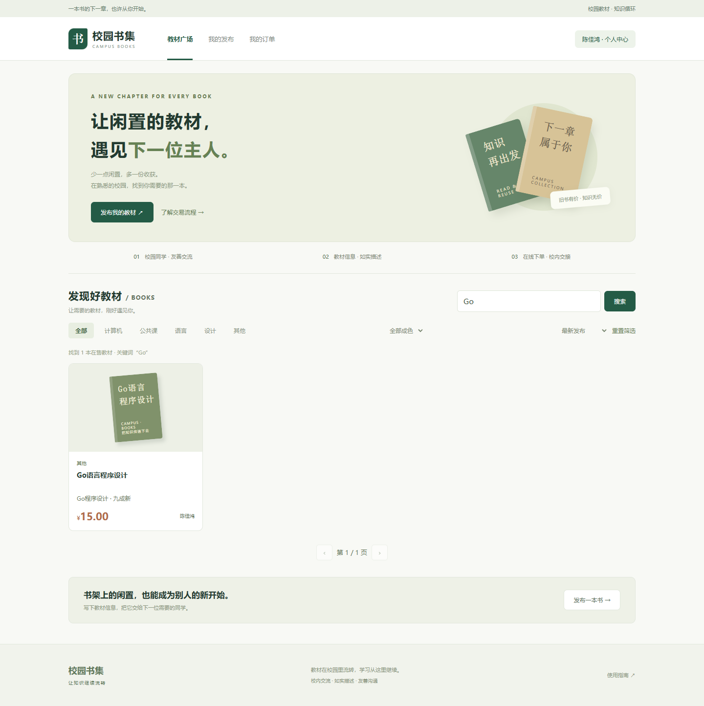

# 校园二手教材交易平台

面向校内学生的教材发布、检索、交流和交易项目，同时用于 Go 后端学习与数据库课程设计。前端使用原生 HTML / CSS / JavaScript，后端使用 Go / Gin / GORM，数据保存在 SQL Server 2012；支持 Docker Compose 部署前后端，并接入支付宝沙箱。

> 课程版交付状态：主要功能和容器部署已实现；自动测试、真实 API 验收和并发下单通过。作者已确认沙箱付款及状态更新成功。本文不宣称已完成生产商户上线、退款或分账。



## 已实现功能

- 姓名登录、学号初始密码、bcrypt 哈希、两小时 JWT、密码显示/隐藏、退出登录；写操作校验账号仍存在。
- 教材发布、书名/课程搜索、分类与成色筛选、排序、浏览器分页、详情和发布人姓名。
- 本人教材查询、编辑、下架，校验归属；交易中教材不能编辑或下架。
- 留言发布、姓名关联、时间倒序、本人删除；教材下架后仍可查询历史留言。
- 买入/卖出订单、订单快照、事务占用教材、取消和释放、历史订单保留。
- 支付宝沙箱付款链接、固定付款期限、通知验签、应用/收款账号/金额核对、幂等入账、主动查单、平台协调取消和确认收货。
- 独立 login.html / index.html / detail.html 页面，桌面与手机适配，错误提示、提交防重复、失败保留输入。

## 快速启动

需要 Go 1.26.2、Node.js 22（本机运行）、SQL Server 2012，以及已配置的支付宝沙箱应用。Docker 模式需要 Docker Desktop 的 Linux 引擎。

### 准备本机配置

```powershell
Copy-Item .env.example .env
```

已有 `.env` 不要覆盖。填写数据库、JWT、账号初始化和沙箱配置，将应用私钥及支付宝公钥保存到 `secrets/`。配置示例不包含任何真实凭据。支付宝公钥和应用公钥不同，填错会明确报错。

- [支付配置与联调](payments/README.md)
- [Docker 部署与维护](docs/部署说明.md)

数据库需预先创建，程序启动自动迁移五张业务表。当前项目保留 SQL Server 2012，不把数据库迁移到新版容器。

### Docker 方式

启动 Docker Desktop 后，在项目根目录运行：

```powershell
.\scripts\Prepare-Docker.ps1 -Start
```

脚本兼容本机 D 盘 Docker 安装，生成 `DOCKER_DB_DSN`、校验 Compose、构建镜像并等待健康。已有容器数据库配置不会被覆盖。首次下载镜像和依赖可能较慢。

```powershell
docker compose ps
docker compose logs --tail 80 backend web
docker compose run --rm seeduser
```

最后一条仅在需要初始化账号时执行，账号取自本机 `.env`，不会默认创建公开测试账号。网站入口：<http://127.0.0.1:5174/login.html>。后端入口：<http://127.0.0.1:8080>。

密钥只读挂载，不进入镜像；后端健康检查会检查数据库。停止原来的 Go/Node 进程后再使用默认端口，SQL Server 和支付隧道保持运行。

### 本机方式

```powershell
go mod download
go run .
```

另开终端：

```powershell
node web/server.mjs
```

首次准备账号：`go run ./cmd/seeduser`。只检查数据库环境：`go run ./cmd/doctor`，不会输出密码或修改数据。

## 技术与目录

```text
main.go                 配置、表迁移、路由、就绪探针、正常停止
config/                 支付配置读取
models/                 用户、教材、留言、订单、支付记录
handlers/               HTTP 参数、权限和响应
payments/               金额转换、SDK、事务、通知入账和测试
cmd/seeduser/           手动初始化账号
cmd/setup-docker/       生成本机容器数据库配置
cmd/doctor/             只读环境检查
integration/            显式启用的真实 API 验收
web/                    独立 HTML 页面、交互、样式和代理
scripts/                启动与测试脚本
compose.yaml            前后端容器及手动账号初始化服务
docs/                   开发文档、部署、接口、截图与验收记录
```

金额以整数分存储，调用支付宝时转成精确元字符串。下单保存书名、价格和联系方式快照。教材状态为 `on_sale / reserved / off_shelf / sold`；订单状态为 `pending / paid / completed / cancelled`。

## 接口与支付流程

- [接口说明](docs/API.md)
- [可复制的 HTTP 请求](docs/requests.http)
- [前端页面与接口约定](web/README.md)

```text
发布教材 → 在售
买家下单 → 教材交易中，订单待支付
沙箱付款并核验 → 教材售出，订单待交接
买家确认收货 → 订单已完成
未支付取消并核实平台状态 → 教材恢复在售，订单已取消
```

付款返回页和刷新按钮会主动查单。浏览器回跳不能作为付款成功依据。已经发出付款链接时，取消必须协调平台状态；平台未知或超时时保留占用，避免重复出售。具体期限和恢复方法见支付说明。

## 验证与交付

```powershell
.\scripts\Test-Project.ps1
```

CI 在推送和 PR 时检查 Go 格式、静态检查、自动测试、JavaScript 语法与 Linux 编译。额外的真实 API、沙箱和 SQL Server 测试须显式开启，详见 [验收记录](docs/验收记录.md)。

已验证环境：SQL Server `11.0.3000.0`（2012）、Go `1.26.2`、Node 22 容器、Docker Linux 引擎。真实 HTTP 并发下单已通过；独立测试库的支付并发集成测试因当前账号没有建库权限而跳过，不能将其表述为通过。

- [软件开发文档 Word](docs/校园二手教材交易平台_软件开发文档.docx)
- [软件开发文档 PDF](docs/校园二手教材交易平台_软件开发文档.pdf)
- [开发文档 Markdown 源稿](docs/软件开发文档.md)
- [课程演示与交付清单](docs/交付清单.md)

封面的班级、学号、指导教师保留可直接填写的位置。项目有 AI 辅助开发，学习者应结合代码、测试与文档理解实现，不把未验证能力写成已验证经验。

## 当前边界

这是单机课程演示版本，不包含真实商家分账、退款、物流、图片上传、在线注册或管理员后台。没有定时清理未付款订单，需用户取消或主动查询已关闭交易释放占用。退出仅清除前端令牌，未实现服务端令牌撤销。

数据库关系目前包含逻辑关联，未全部建立物理外键。列表筛选、分页主要在浏览器完成，尚未进行生产级负载验收。生产部署需要另行完成账号策略、HTTPS、数据备份、监控和正式支付资质，不应直接把课程版当作已验证的生产金融系统。
