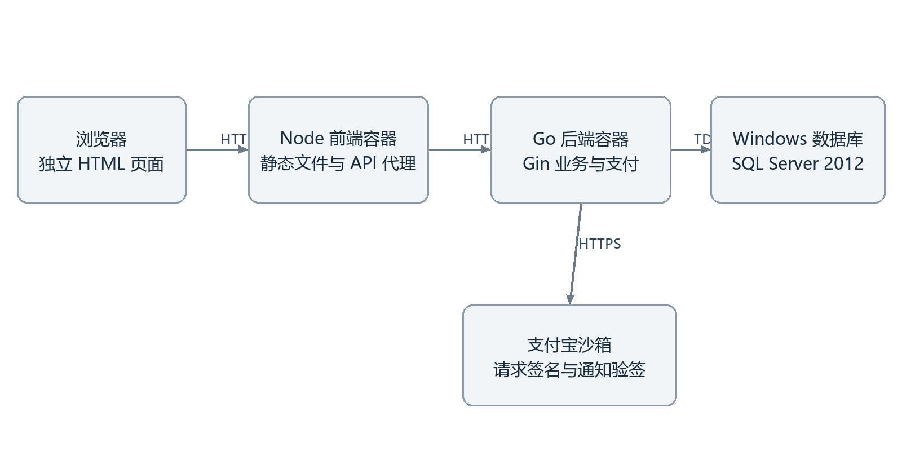
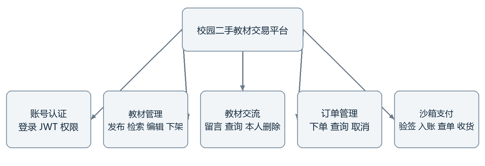
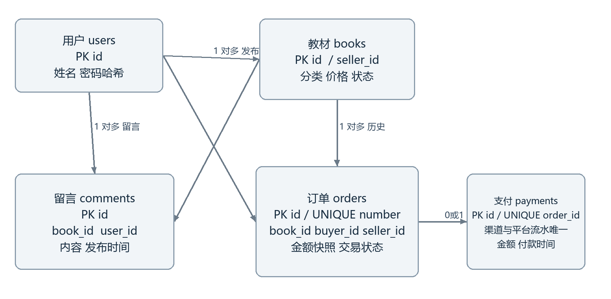
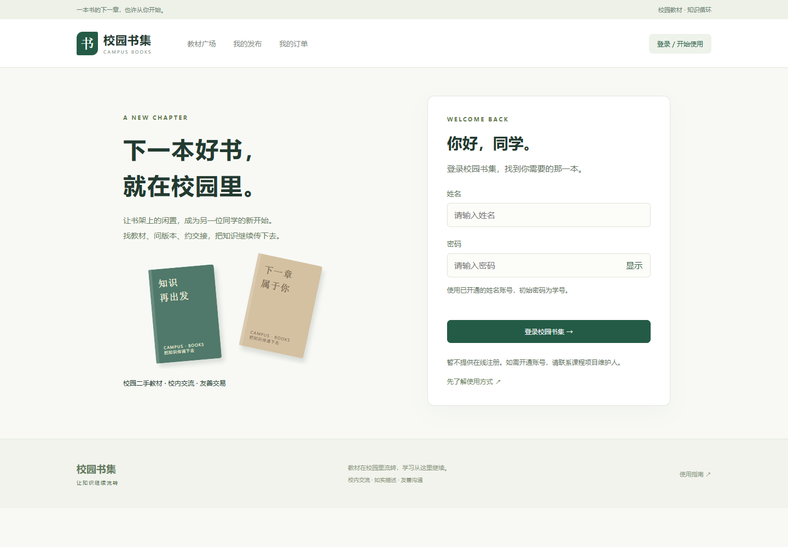
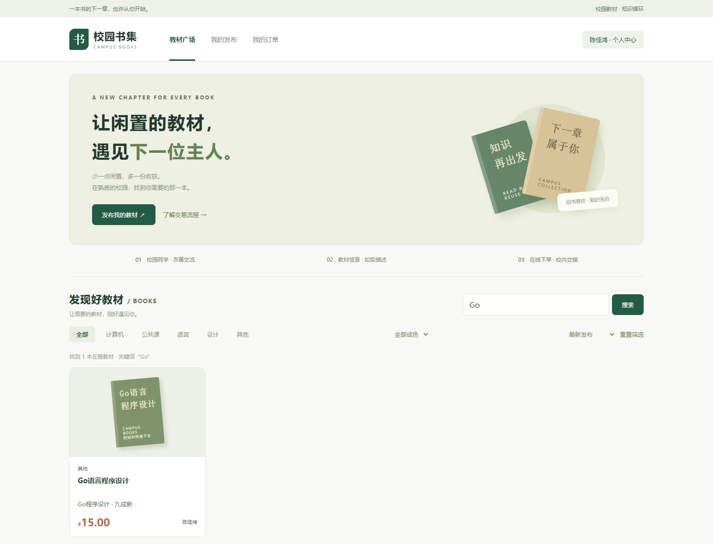
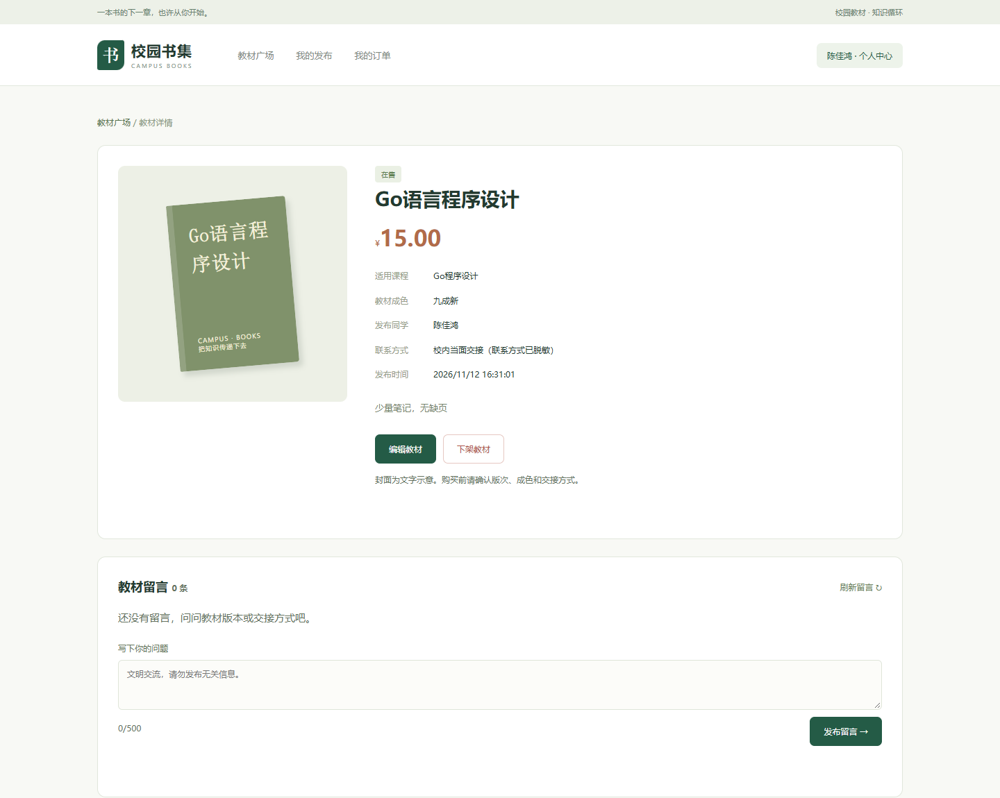
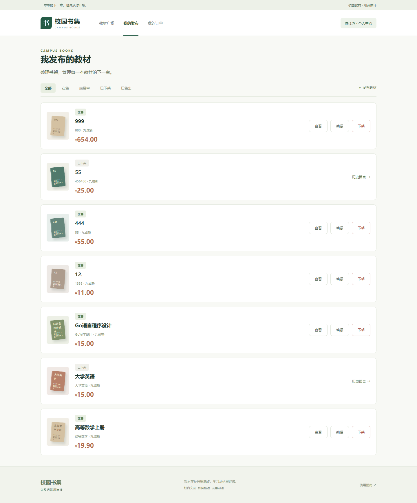
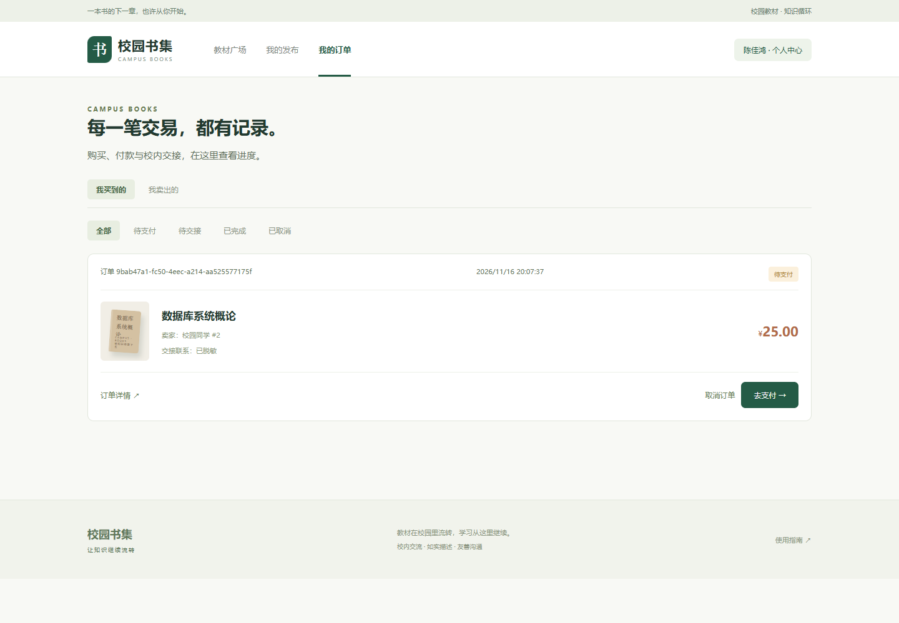

# 校园二手教材交易平台软件开发文档

姓名：陈佳鸿；班级、学号、指导教师请在Word首页填写。
课程指定完成日期：2026-11-30；技术记录日期：2026-11-16。

## 三 项目背景与意义

大学生每学期需要购买课程教材，课程结束后，大量教材仍具有使用价值，但转让信息通常分散在班级群和社交平台中。信息容易被新消息覆盖，书名、版次、适用课程、成色与价格也缺少统一的展示方式。买家需要反复询问教材是否仍在出售，卖家则难以持续维护发布信息，交易过程缺少清晰的记录。

本项目面向校内学生建设二手教材交易网站，将教材信息、留言和订单集中保存在SQL Server数据库中。用户通过姓名登录后，可以按书名或课程检索教材，查看详细描述和联系方式，在留言区确认版本与交接安排，也可以发布、编辑或下架自己的教材。订单保存下单时的书名、价格和联系方式，避免教材信息变化影响历史交易；支付宝沙箱用于练习签名、通知验签和支付状态同步。

系统的意义在于提高校内教材信息的可查找性，让教材循环使用，同时将网站、Go接口和关系数据库连接成一个可验证的课程实践。开发过程采用AI辅助，并通过代码阅读、测试和实际接口验证检查实现结果。第一版聚焦校内信息交流与单本教材交易，不包含物流、平台分账和复杂退款。

### 3 1 项目目标

完成课程要求的登录、主界面、详情与留言模块，并扩展教材归属管理、交易一致性、沙箱支付和Docker部署。交付包含源码、环境配置示例、操作说明、测试记录及本文档。

### 3 2 版本范围

技术记录截至2026年11月16日，课程指定完成日期为2026年11月30日。作者已反馈沙箱付款及项目状态更新成功；本文将用户实测、自动测试和未验证项目分别记录。

## 四 需求分析

### 4 1 功能需求

| 编号 | 功能 | 验收要点 |
| --- | --- | --- |
| FR01–03 | 登录与退出 | 姓名和学号初始密码、错误提示、密码显隐、退出返回登录页 |
| FR04–06 | 教材浏览 | 数据库列表、书名或课程搜索、详情与联系方式 |
| FR07–09 | 教材管理 | 发布、编辑本人教材、下架保留历史、禁止越权 |
| FR10–11 | 留言交流 | 关联用户和教材、非空校验、作者姓名、时间倒序 |
| FR12 | 提交订单 | 保存买卖双方与金额快照，禁止购买本人或非在售教材 |
| FR13–14 | 在线支付 | 沙箱付款、验签与金额核对、重复通知不重复入账 |
| FR15 | 订单查询 | 仅交易双方可查，按买入卖出及状态筛选 |
| 扩展 | 交付维护 | 本人留言删除、确认收货、容器健康检查和CI |

### 4 2 非功能需求

| 类别 | 实现要求 |
| --- | --- |
| 易用与兼容 | 中文页面、清晰反馈、桌面与手机布局、失败保留输入 |
| 安全 | bcrypt密码哈希、JWT与账号存在校验、后端归属检查、参数化SQL、输出转义 |
| 可靠 | 事务处理教材与订单状态，支付记录唯一索引，平台状态未知时不释放教材 |
| 可维护 | 模型、HTTP处理、支付服务分离，集中API请求，配置与密钥不进入镜像 |
| 性能范围 | 面向课程演示和少量用户；不宣称已通过生产负载测试 |

### 4 3 业务边界

使用预先初始化账号，不提供公开注册和管理后台。教材为单本交易，订单可有多次取消历史。仅使用统一沙箱商家收款，不涉及真实资金分账或退款。

## 五 系统总体设计

### 5 1 系统架构



浏览器加载独立HTML页面，页面脚本调用同源/api接口。Node服务转发请求给Go，Go通过Gin解析参数并调用GORM访问SQL Server。支付请求由后端签名；支付宝通知通过公网HTTPS隧道到达后端，浏览器不接触平台私钥。

Docker将Node与Go分别运行在Linux容器中，使用backend服务名通信；SQL Server 2012继续运行在Windows，通过host.docker.internal访问。数据库不随容器删除。

### 5 2 技术选型

| 技术 | 选型理由 |
| --- | --- |
| Go 1.26.2 / Gin | 语言和框架便于学习HTTP请求处理，中间件可复用认证逻辑 |
| GORM / SQL Server 2012 | 沿用课程指定数据库，通过模型映射和参数化查询完成业务 |
| 原生HTML CSS JavaScript | 无需前端构建链，便于理解页面、表单和接口之间的关系 |
| JWT / bcrypt | 分别用于短期身份凭据和单向密码哈希 |
| 支付宝沙箱 / RSA2 | 练习支付签名、通知验签、金额核对和幂等处理 |
| Docker Compose | 固定运行环境，集中配置服务网络、端口、只读密钥和健康检查 |

## 五 系统总体设计 续

### 5 3 功能模块划分



账号认证模块签发和验证JWT；教材模块管理发布与在售状态；留言模块负责交流记录和本人删除；订单模块保存交易快照并占用教材；支付模块统一协调付款、取消、入账、主动查单和确认收货。

### 5 4 代码组织

| 目录 | 职责 |
| --- | --- |
| models | 用户、教材、留言、订单与支付模型 |
| handlers | 读取HTTP输入、身份与归属检查、响应状态码 |
| payments | SDK边界、整数金额、支付业务事务 |
| config | 读取并校验支付配置与密钥文件 |
| web | 独立页面、渲染交互、样式、API客户端与本地代理 |
| cmd | 账号初始化、Docker配置准备、只读环境诊断 |
| integration | 显式开启的真实API验收与临时数据清理 |

### 5 5 请求与错误处理

常规成功响应使用message与data，输入错误返回400，身份失效返回401，归属不符返回403或不泄露订单存在性的404，状态冲突返回409。支付宝通知使用纯文本success或failure，不能套用普通JSON成功响应。

## 六 数据库设计

### 6 1 概念结构



一名用户可以发布多本教材、发表多条留言，并分别作为买家和卖家参与订单。一本教材可以有多条留言与历史订单，但同时只允许一笔有效占用。订单成功付款后最多对应一条成功支付记录。

### 6 2 关联实现

当前模型保存关联编号，教材、留言、订单的有效性和资源归属主要在应用层校验。图中的连线表示逻辑关系，并不表示所有字段已经建立数据库物理外键。报告中明确区分逻辑设计与实际约束，避免将应用关联误写为外键约束。

主键由数据库生成。业务订单号唯一；支付OrderID唯一；Provider与TradeNo组成联合唯一索引。下架只改变教材状态，保留教材、留言和订单；本人删除留言属于物理删除。

## 六 数据库设计 用户与教材

### 6 3 用户表 users

| 字段 | 类型与约束 | 说明 |
| --- | --- | --- |
| id | bigint 主键 自增 | 用户编号 |
| name | nvarchar(50) 非空 | 姓名登录，可重名 |
| password_hash | nvarchar(255) 非空 | bcrypt哈希，JSON不返回 |
| created_at | datetimeoffset | 创建时间 |
| updated_at | datetimeoffset | 更新时间 |

### 6 4 教材表 books

| 字段 | 类型与约束 | 说明 |
| --- | --- | --- |
| id | bigint 主键 自增 | 教材编号 |
| title | nvarchar(100) 非空 | 书名 |
| course | nvarchar(100) 非空 | 适用课程 |
| category | nvarchar(20) 非空 默认其他 | 分类 |
| condition | nvarchar(50) 非空 | 成色 |
| price | bigint 非空 | 人民币整数分 |
| description | nvarchar(1000) | 补充说明 |
| contact | nvarchar(100) 非空 | 联系方式 |
| seller_id | bigint 非空 | 逻辑关联用户 |
| status | nvarchar(20) 非空 | 在售 交易中 下架 售出 |
| created_at / updated_at | datetimeoffset | 创建及更新时间 |

金额使用整数分避免浮点误差。用户姓名未设置唯一约束，登录按同名用户逐个比较密码哈希；同名不同密码的账号可能并存，初始化工具不是密码重置工具。

## 六 数据库设计 留言与订单

### 6 5 留言表 comments

| 字段 | 类型与约束 | 说明 |
| --- | --- | --- |
| id | bigint 主键 自增 | 留言编号 |
| book_id | bigint 非空 索引 | 所属教材 |
| user_id | bigint 非空 索引 | 留言作者 |
| content | nvarchar(500) 非空 | 内容，应用拒绝空白 |
| created_at | datetimeoffset | 发布时间 |

### 6 6 订单表 orders

| 字段 | 类型与约束 | 说明 |
| --- | --- | --- |
| id | bigint 主键 自增 | 内部订单编号 |
| number | nvarchar(64) 非空 唯一 | 平台out_trade_no使用此值 |
| book_id | bigint 非空 索引 | 教材编号 |
| buyer_id / seller_id | bigint 非空 各有索引 | 买卖双方 |
| title | nvarchar(100) 非空 | 书名快照 |
| price | bigint 非空 | 金额快照，单位分 |
| contact | nvarchar(100) 非空 | 联系方式快照 |
| status | nvarchar(20) 非空 索引 | pending paid completed cancelled |
| payment_started_at | datetimeoffset 可空 | 首次发出付款链接 |
| payment_expires_at | datetimeoffset 可空 | 固定绝对截止时间 |
| paid_at | datetimeoffset 可空 | 付款确认时间 |
| completed_at / cancelled_at | datetimeoffset 可空 | 收货或取消时间 |
| created_at / updated_at | datetimeoffset | 创建及更新时间 |

## 六 数据库设计 支付与约束

### 6 7 成功支付记录表 payments

| 字段 | 类型与约束 | 说明 |
| --- | --- | --- |
| id | bigint 主键 自增 | 记录编号 |
| order_id | bigint 非空 唯一 | 每订单最多一条成功记录 |
| provider | nvarchar(20) 非空 | 渠道alipay，联合唯一索引成员 |
| trade_no | nvarchar(64) 非空 | 平台流水，联合唯一索引成员 |
| amount | bigint 非空 | 核验后金额，单位分 |
| paid_at | datetimeoffset | 平台付款时间 |
| created_at | datetimeoffset | 本系统保存时间 |

### 6 8 状态与一致性约束

| 操作 | 教材状态 | 订单状态 |
| --- | --- | --- |
| 下单 | on_sale → reserved | 新建pending |
| 付款核验 | reserved → sold | pending → paid |
| 未付款取消 | reserved → on_sale | pending → cancelled |
| 确认收货 | 保持sold | paid → completed |

教材的BookID不能直接设置唯一订单索引，因为取消后允许重新下单并保留历史。有效占用通过条件UPDATE和事务控制，支付重复通过订单锁与唯一索引共同约束。

### 6 9 迁移与备份

启动时AutoMigrate创建或补充表结构，不负责创建数据库实例和登录账号。Docker仍使用原Windows数据库。升级前在SQL Server管理工具中备份数据库，配置与私钥只在本机保存，不进入Git仓库。

## 七 详细设计与实现 登录模块

### 7 1 登录与密码显隐



登录页为login.html，用户输入姓名和学号初始密码。前端通过POST /api/login提交JSON，后端查询同名用户并使用bcrypt比较哈希；成功签发两小时JWT，随后跳转index.html或原受保护页面。

```
if err := bcrypt.CompareHashAndPassword(
    []byte(user.PasswordHash), []byte(request.Password),
); err == nil {
    // 身份匹配后签发 JWT，不返回密码哈希。
}
```

密码切换按钮使用type=button，只修改输入框type，不提交表单。令牌保存在sessionStorage；401会清理并跳转登录。后端验证JWT后再查账号存在性，防止已删除账号继续写入。

## 七 详细设计与实现 主界面

### 7 2 教材列表与检索



首页展示书名、课程、成色、价格与发布人。后端使用LEFT JOIN读取姓名，不向前端返回用户密码哈希。书名与课程搜索条件置于同一括号，确保不会绕过在售筛选。

```
query := h.DB.Table("books AS b").
    Select("b.*, COALESCE(u.name, '') AS seller_name").
    Joins("LEFT JOIN users AS u ON u.id = b.seller_id").
    Where("b.status = ?", "on_sale")
query = query.Where("(b.title LIKE ? OR b.course LIKE ?)", pattern, pattern)
```

分类、成色、价格排序和分页目前由浏览器处理。分类已持久化，缺省归其他；空结果返回空数组并显示可读提示。

## 七 详细设计与实现 详情与交流

### 7 3 教材详情与留言



detail.html?id=编号读取在售教材详情，包含描述和联系方式。留言查询连接users取得作者姓名，按created_at、id降序稳定排列。发布需登录并清理空白，删除仅允许留言作者。

教材下架后普通详情不再公开展示，但comments.html仍可查询历史留言且不显示新增表单。用户输入在插入页面前进行HTML转义，避免留言被当作脚本执行。

## 七 详细设计与实现 教材管理

### 7 4 本人教材与发布编辑



发布人编号从已验证的JWT上下文读取，不接受浏览器自行指定。编辑和下架同时检查教材归属与on_sale状态；真正执行UPDATE时再次带上编号、发布人和状态条件。交易中教材不允许被卖家改价或下架。

```
result := h.DB.Model(&models.Book{}).
    Where("id = ? AND seller_id = ? AND status = ?",
        bookID, userID, "on_sale").
    Updates(updates)
```

编辑通过map列出允许修改的字段，使空描述可以真正清空。下架修改status而非DELETE，避免破坏历史留言和订单关联。

## 七 详细设计与实现 订单和支付

### 7 5 下单与取消

下单在事务内先把在售教材条件更新为reserved，再读取最新教材信息保存订单快照。两个并发买家只有一个请求能匹配在售状态。购买本人教材或订单插入失败时回滚占用。

```
err := h.DB.Transaction(func(tx *gorm.DB) error {
    result := tx.Model(&models.Book{}).
        Where("id = ? AND status = ?", bookID, "on_sale").
        Update("status", "reserved")
    // 检查 Error 与 RowsAffected 后创建订单。
    return tx.Create(&order).Error
})
```

### 7 6 通知核验与入账

回调接收表单而非JSON，限制请求体大小并拒绝重复参数。SDK验签后，继续核对app_id、seller_id、通知类型、交易状态、业务订单号和金额。支付金额由精确转换函数从元字符串转为分，与订单快照比较。

入账统一先锁教材再锁订单，SQL Server使用UPDLOCK和ROWLOCK。保存支付记录、教材售出和订单已支付在同一个事务中提交。重复通知需与原记录的渠道、流水、金额及状态完全匹配，不能把已完成订单退回已支付。

### 7 7 支付取消竞态

首次发链保存固定15分钟截止时间。取消时先确认平台交易关闭；已付款则核验入账并拒绝取消，超时或未知状态保留占用。有效链接尚未创建平台交易时，不能仅凭交易不存在立即释放教材；链接过期并等待一分钟后仍需主动查单确认。

### 7 8 收货确认

只有买家能确认paid订单，教材必须保持sold并存在金额一致的支付记录。重复确认保留原完成时间。当前不包含退款和自动定时清理。

## 七 详细设计与实现 容器部署

### 7 9 Docker与环境配置

Go镜像分为编译和运行阶段，运行镜像只保留程序、CA证书和时区数据，使用普通用户。前端镜像使用Node 22并监听0.0.0.0。Compose通过内部backend服务名通信，对外仅绑定本机端口。

```
services:
  backend:
    image: campus-books-backend:dev
    ports: ["127.0.0.1:8080:8080"]
    # 密钥目录只读挂载，不复制到镜像。
  web:
    image: campus-books-web:dev
    environment:
      BACKEND_URL: http://backend:8080
```

后端访问Windows数据库使用host.docker.internal。准备脚本从已有DB_DSN生成DOCKER_DB_DSN，不输出密码；.dockerignore排除.env与secrets。支付返回地址供浏览器访问，仍使用localhost前端地址；通知地址则使用公网HTTPS隧道。

### 7 10 启动与维护

```
.\scripts\Prepare-Docker.ps1 -Start
docker compose ps
docker compose logs --tail 80 backend web
docker compose run --rm seeduser
docker compose stop
```

容器健康检查调用/api/ready，实际检查数据库连通性。前端等待后端健康后启动；Go收到停止信号时先等待请求完成，再关闭数据库连接池。停止容器不删除Windows数据库。

## 八 系统测试

### 8 1 测试环境

| 项目 | 已核实环境 |
| --- | --- |
| 操作系统 | Windows宿主机与Docker Linux容器 |
| 数据库 | SQL Server 2012，11.0.3000.0，Enterprise Edition |
| 后端 | Go 1.26.2，Gin与GORM |
| 前端 | Node 22镜像，原生JavaScript |
| 浏览器 | Playwright管理的Chromium，桌面1440宽与手机390宽 |
| 测试工具 | Go testing、sqlmock、本机HTTP模拟、真实API与浏览器 |
| 支付 | 支付宝沙箱，RSA2公钥模式，统一商家收款 |

### 8 2 测试分层

金额函数检查上下限、精确小数和非法格式。SDK测试保留真实请求签名与响应验签，仅将HTTP目标替换为独立本机服务。通知测试使用单独生成的应用与平台RSA密钥，不读取真实私钥作为测试样例。SQL mock验证事务分支，不能替代真实锁调度验证。

真实API验收在显式开启后创建临时测试账号与数据，通过运行中的容器后端访问实际SQL Server。验收结束只清理这些账号关联的记录，不修改已有用户资料。付款链接仅生成、不打开，自动验收不执行实际付款。

```
.\scripts\Test-Project.ps1
$env:CAMPUS_API_TEST='1'
go test ./integration -v -count=1
Remove-Item Env:CAMPUS_API_TEST
```

## 八 系统测试 用例与结果

### 8 3 功能与权限用例

| 用例 | 预期 | 结果 |
| --- | --- | --- |
| 正确姓名密码登录 | 200并返回令牌 | 真实API通过 |
| 错误密码或匿名发布 | 401，拒绝写入 | 真实API通过 |
| 密码显隐 | 切换显示，不提交表单 | 浏览器通过 |
| 分类与发布人姓名 | 保存分类并关联正确姓名 | 真实API通过 |
| 他人教材编辑 | 403，原数据不变 | 真实API通过 |
| 编辑价格与清空描述 | 准确保存整数分及空描述 | 真实API通过 |
| 留言空白与他人删除 | 400 / 403 | 真实API通过 |
| 本人留言删除 | 200且列表移除 | 真实API通过 |
| 两个买家同时下单 | 恰好一个201、一个409 | 真实并发通过 |
| 交易中下架 | 409，保持占用 | 真实API通过 |
| 第三人查询订单 | 404 | 真实API通过 |
| 旧取消遇到新占用 | 不释放新订单教材 | 真实API通过 |
| 未付款确认收货 | 409 | 真实API通过 |
| 账号删除后旧JWT | 401 | 真实API与单测通过 |

### 8 4 支付与故障用例

| 用例 | 预期 | 结果 |
| --- | --- | --- |
| 金额19.99元转换 | 1999分，无浮点误差 | 单测通过 |
| 错误签名或篡改通知 | 拒绝，不更新订单 | 签名测试通过 |
| 错误应用或收款方 | 拒绝 | 通知测试通过 |
| 重复成功通知 | 一条记录，不重复入账 | 事务与HTTP测试通过 |
| 订单更新失败 | 支付和教材更新一起回滚 | SQL mock通过 |
| 平台超时或状态未知 | 保留教材占用 | 服务测试通过 |
| 成功付款与项目状态 | paid或completed | 作者实测确认 |

## 八 系统测试 验收证据与边界

### 8 5 页面与容器证据



本轮实际构建前后端镜像，使用临时端口验证连接原Windows SQL Server，两项Compose服务均达到healthy。真实API验收包含一次双请求并发下单并通过；采集页面来自真实API，未用模拟库存替代。

### 8 6 未验证与限制

作者确认已完成沙箱付款且项目状态正确；本轮未代为再次付款。当前数据库账号没有建库权限，独立数据库中的多通知并发入账、付款与取消同时发生等测试被明确跳过。真实并发下单通过不等于全部支付竞态已在真实数据库验证。

未完成生产负载、真实资金分账、退款、自动超时清理和高可用验收。系统定位为课程演示与学习项目。退出登录未实现服务端令牌撤销，实体间也未全部设置物理外键，这些均作为后续改进点保留。

## 九 总结与心得体会

本项目将教材信息管理、用户认证、数据库读写和交易状态处理结合起来，使我能够围绕一条实际业务流程理解前后端如何协作。开发中采用AI辅助，我在代码阅读、逐步修改和运行验证中，逐渐区分了路由登记与函数调用、身份认证与资源权限、数据库查询对象与查询结果等概念。与直接复制完整代码相比，按小功能理解输入、处理和输出，更有助于定位问题。

数据库方面，教材与用户通过编号关联，留言查询需要连接用户表取得姓名，订单则需要保存价格快照。金额以整数分保存，让我认识到支付数据不能随意使用浮点数。下单和取消必须让多个写操作共同成功或失败，因此事务、条件更新、锁和唯一索引承担不同职责，不能只依赖前端禁用按钮。支付通知也必须先验签并核对业务字段，浏览器返回页面不能证明付款成功。

工程实践方面，Docker将运行环境与本机开发环境分开，容器中的localhost与Windows宿主机不是同一地址，密钥应只读挂载而不是复制进镜像。测试进一步说明了编译通过、模拟接口通过和真实数据库通过是不同证据。后续我需要继续练习SQL、Go错误处理和并发测试，补充服务端令牌撤销、数据库外键、服务端分页及超时任务，并在理解实现的基础上完善项目。

### 9 1 后续改进

优先补齐真实数据库支付并发场景；在业务范围明确后加入未支付超时任务、账号维护和更多可观测日志。生产支付上线需要独立完成正式资质、退款、风控和数据安全设计，不直接复用课程沙箱验收结论。

## 十 参考文献

[1] 课程设计任务书，用户提供，要求SQL Server 2012及软件开发文档十部分结构，课程指定完成日期2026年11月30日。

[2] 校园二手教材交易系统需求规格说明书，V1.0，2026年10月29日。

[3] Go Documentation. https://go.dev/doc/ ，访问日期2026年11月16日。

[4] Gin Web Framework Documentation. https://gin-gonic.com/docs/ ，访问日期2026年11月16日。

[5] GORM Guides. https://gorm.io/docs/ ，访问日期2026年11月16日。

[6] Microsoft SQL Server Documentation. https://learn.microsoft.com/sql/ ，访问日期2026年11月16日。

[7] Docker Compose Documentation. https://docs.docker.com/compose/ ，访问日期2026年11月16日。

[8] 支付宝开放平台与沙箱控制台. https://open.alipay.com/ ，访问日期2026年11月16日。

[9] smartwalle/alipay Go SDK，v3.2.31. https://github.com/smartwalle/alipay ，访问日期2026年11月16日。

### 附录 交付索引

根目录README提供快速启动；docs/API.md提供接口与权限约定；docs/部署说明.md提供Docker启动和排错；payments/README.md解释支付状态与测试；docs/验收记录.md区分真实验收、模拟测试和未验证内容。源码仓库：https://github.com/fuyao0612/campus-books。
